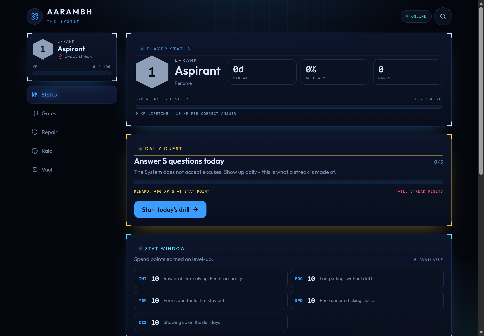
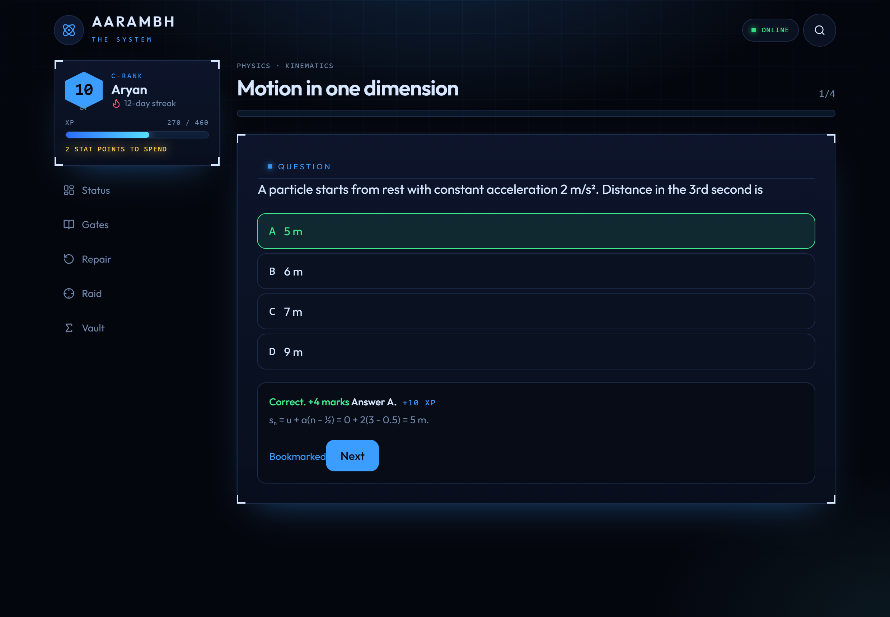
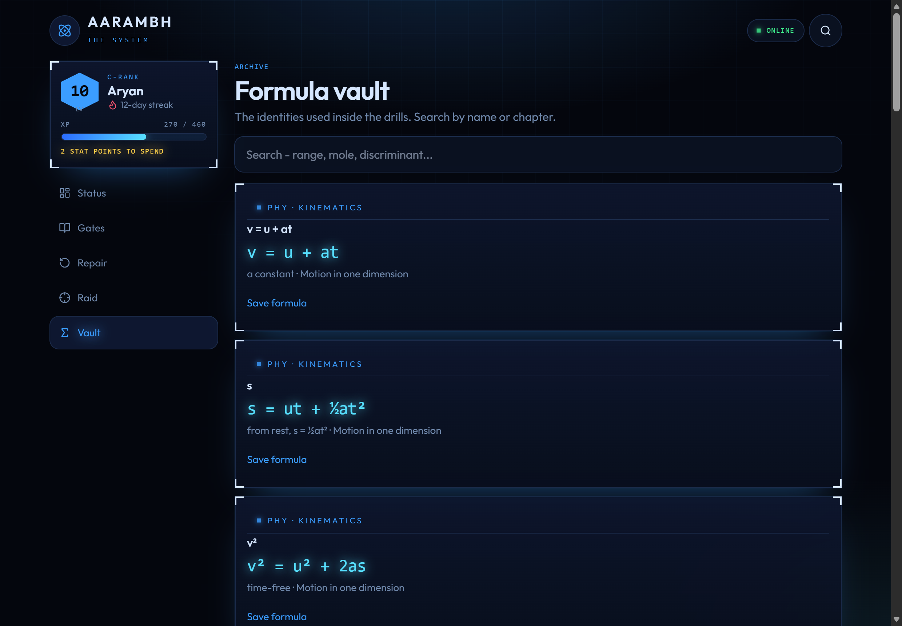
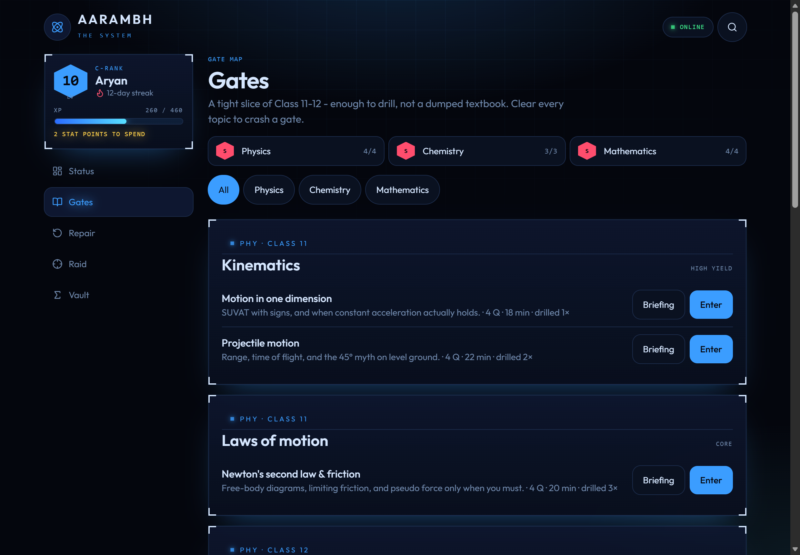

# Aarambh - The System

> A leveling system for JEE Main & Advanced — daily quests, gates, and raids that keep you consistent.


**Aarambh** is a gamified, offline-first JEE study app built around discipline and consistency. It tracks XP, levels, ranks, stats, streaks, and gate completion while keeping all progress encrypted locally in the vault.

## Screenshots

| Home — Player Status | Practice — Question Feedback |
|---|---|
|  |  |

| Formulas Reference | Syllabus & Gates |
|---|---|
|  |  |

## Features

- **Solo Leveling-style progression** — XP on correct/attempted answers and lessons, automatic level-ups with +3 stat points per level. Level formula: `xpToNext = 100 + (level-1)*40`.
- **Rising ranks** — E, D, C, B, A, S, NATIONAL based on level (`1/5/10/18/28/40/60`).
- **Attribute system** — Stats: INT, FOC, MEM, SPD, DIS (base 10). Spend points earned on level-up to shape your build.
- **Daily Quest** — Answer 5 questions/day (`+60 XP`, `+1 stat point` on clear). Miss a day after a streak and it resets with a penalty notification.
- **Gates per subject** — Physics, Chemistry, Mathematics gates track % of topics drilled with rank grades (E→S).
- **Structured content** — 3 subjects · 9 chapters · 11 topics · 44 questions with clear explanations, formulas, and references.
- **Learn, Practice, Mock, Revise** — Read, drill topic-wise, timed-like practice, revise mistakes/bookmarks with a clean console-like UI.
- **Offline-first & local-only** — All progress lives in `localStorage` (`aarambh-progress-v1`). No backend, no analytics, no tracking.
- **Encrypted Vault** — Optional AES-256-GCM vault with PBKDF2-SHA256 (200000 iterations). Envelope format `v:2` with salt/IV/data; passphrase never stored. Unlock/lock from the UI; wrong passphrase fails GCM auth (no garbage decryption).
- **Hardened Security** — Max CSP with `require-trusted-types-for 'script'` + `trusted-types default`, strict security headers (COOP/COEP/CORP, HSTS, Permissions-Policy, frame-ancestors), header drift checks, supply-chain lockdown, and CI security gates.
- **Self-hosted fonts** — Outfit WOFF2 only, no external font CDNs. Dark neon/terminal aesthetic with Tailwind v4.

## Tech Stack

- **Framework**: [React 19](https://react.dev/) + [TypeScript](https://www.typescriptlang.org/)
- **Build**: [Vite 8](https://vitejs.dev/) + [`@tailwindcss/vite`](https://tailwindcss.com/)
- **Routing**: [React Router 7](https://reactrouter.com/) (`HashRouter`, client-only)
- **Styling**: [Tailwind CSS v4](https://tailwindcss.com/) (theme tokens, custom glow/grid)
- **Icons**: [Lucide React](https://lucide.dev/)
- **Security**: WebCrypto (AES-GCM, PBKDF2), CSP + Trusted Types, hardened headers
- **Tooling**: ESLint 9 (flat config, react-hooks, security plugin), TypeScript ESLint, header drift check, vault round-trip test

## Getting Started

### Prerequisites
- Node 22+ (LTS recommended). Built/tested with Node v26.8.1.
- npm 11+

### Install

```bash
npm ci
```

### Development

```bash
npm run dev
```
Runs on `http://localhost:5173/` (note: `127.0.0.1` may not work in this setup).

### Typecheck, Lint, Build

```bash
npm run typecheck  # tsc --noEmit
npm run lint       # eslint .
npm run build      # tsc --noEmit + header check + vite build
npm run preview    # preview built dist
```

### Scripts

| Script | Purpose |
|---|---|
| `dev` | Vite dev server |
| `build` | Typecheck, header drift check (`scripts/check-headers.mjs`), Vite build (injects CSP meta at build-time) |
| `typecheck` | TypeScript noEmit |
| `lint` | ESLint flat config |
| `check:headers` | Verifies `public/_headers` and `vercel.json` security headers match `security/csp.js` |
| `test:vault` | WebCrypto AES-GCM + PBKDF2 round-trip test (`scripts/vault-roundtrip.mjs`) |
| `audit` | `npm audit --audit-level=high` |
| `preview` | Local preview of `dist/` |

## Security

- **Content Security Policy** — `default-src 'self'`, `script-src 'self'`, `style-src 'self'`, `img-src 'self' data:`, `font-src 'self'`, `require-trusted-types-for 'script'`, `trusted-types default`, `frame-ancestors 'none'`, `upgrade-insecure-requests`. CSP meta injected in production only (`vite.config.ts`).
- **Trusted Types** — Enforced; unsafe HTML sinks are blocked. `innerHTML='<b>x</b>'` throws `TypeError` under enforcement.
- **Security Headers** — 11 hardened headers across `public/_headers` (Netlify/Cloudflare-style) and `vercel.json` (Vercel): `X-Content-Type-Options: nosniff`, `X-Frame-Options: DENY`, `Referrer-Policy: no-referrer`, `X-Permitted-Cross-Domain-Policies: none`, `X-XSS-Protection: 0`, `COOP/COEP/CORP` (`same-origin`/`require-corp`/`same-origin`), `HSTS` (preload), strict `Permissions-Policy`, and CSP (prod). Drift check enforced in build/CI.
- **Encrypted Vault** — WebCrypto AES-256-GCM, PBKDF2-SHA256 200000 iterations, 16B salt, 12B IV. Envelope `{v:2,enc:true,kdf:"PBKDF2",hash:"SHA-256",iter,salt,iv,data}`. Passphrase never stored; GCM auth failures return `false` (no partial plaintext).
- **Supply-chain Hardening** — `.npmrc` sets `ignore-scripts=true` and `save-exact=true`. Dev deps pinned where relevant.
- **CI/CD** — GitHub Actions workflow runs: `npm ci` (lifecycle scripts suppressed), `npm audit --audit-level=high`, `typecheck`, `lint`, `check:headers`, `test:vault`, `build` on push/PR and weekly.
- **Client-only** — HashRouter SPA, `base: "./"`, no SSR, no external third-party scripts/fonts.

## Project Structure

```text
aarambh-web/
├── .github/
│   ├── workflows/security.yml  # CI security gates
│   └── dependabot.yml
├── public/
│   ├── _headers                 # Security headers (static hosts)
│   └── favicon.svg
├── scripts/
│   ├── check-headers.mjs       # CSP/headers drift check
│   └── vault-roundtrip.mjs     # Vault crypto round-trip test
├── security/
│   ├── csp.js                   # CSP + SECURITY_HEADERS single source of truth
│   ├── csp.d.ts
│   ├── vault.js                 # WebCrypto vault (AES-GCM + PBKDF2)
│   └── vault.d.ts
├── src/
│   ├── components/
│   │   ├── Hud.tsx              # XP/rank UI
│   │   ├── OptionList.tsx       # Shared MCQ options (deduped)
│   │   ├── PlayerCard.tsx
│   │   ├── Shell.tsx
│   │   ├── SystemNotifications.tsx
│   │   ├── SystemWindow.tsx
│   │   └── Vault.tsx            # Vault UI (engage/unlock/lock)
│   ├── fonts/
│   │   ├── outfit-latin.woff2   # Self-hosted font
│   │   └── fraunces-latin.woff2
│   ├── lib/jee/
│   │   ├── content.ts           # JEE content (Physics/Chem/Math)
│   │   ├── store.ts             # Progress + XP + stats + vault state
│   │   ├── system.ts            # XP/levels/ranks/stats/titles
│   │   └── types.ts
│   ├── pages/
│   │   ├── Home.tsx
│   │   ├── Syllabus.tsx
│   │   ├── Learn.tsx
│   │   ├── Practice.tsx
│   │   ├── Mock.tsx
│   │   ├── Revise.tsx
│   │   ├── Formulas.tsx
│   │   ├── Search.tsx
│   │   └── NotFound.tsx
│   ├── App.tsx
│   ├── main.tsx
│   └── styles.css              # Tailwind v4 theme + grid/glow
├── index.html                  # CSP meta injected at build-time
├── vite.config.ts              # systemCsp() plugin, base: "./"
├── eslint.config.js            # Flat ESLint config
├── .npmrc                      # ignore-scripts, save-exact
├── tsconfig.json
├── vercel.json                 # Vercel security headers
└── README.md
```

## Notes

- **Content**: Curated JEE-relevant questions with concise explanations and formulas. Math symbols (², ½, subscripts, Greek, operators) are preserved as-is.
- **Design**: "System" console aesthetic — monochrome dark with cyan/gold/glow accents. No emojis, no AI tells in UI copy.
- **Humanized code**: Readability-first, minimal comments (explain *why*, not *what*), domain-specific names, specific exception handling, direct returns over envelopes.
- **Portability**: Static SPA (no backend). Works on static hosts (Vercel, Netlify, GitHub Pages, S3+CloudFront) with the provided security headers.

## License

MIT © Aryan Pandey

[**→ View on GitHub**](https://github.com/ap371-cloud/aarambh-web)
